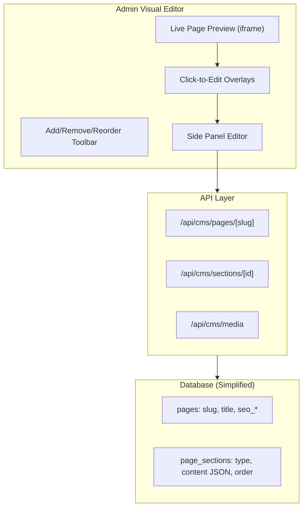

# WYSIWYG CMS Refactor Plan

## Problem Summary

The current CMS is broken in several ways:

- **Data mismatch**: CMS sections use different column names (`section_type` vs `section`) and store data in inconsistent places (`content`, `json_content`, direct fields)
- **Unusable editor**: Generic section forms don't match what each page actually needs
- **Disconnected from frontend**: No visual feedback - admins can't see what their edits will look like
- **Too abstract**: Section types like "hero", "intro", "features" are meaningless without context

## Architecture



## Implementation Plan

### Phase 1: Visual Editor Framework

- Create `/admin/visual-editor/[slug]` route with iframe-based live preview
- Build edit overlay system - clicking elements highlights them and opens side panel
- Implement section toolbar for add/remove/reorder with drag-and-drop
- Add real-time preview updates as content changes

Key files:

- New: `app/admin/visual-editor/[slug]/page.tsx`
- New: `components/admin/visual-editor/LivePreview.tsx`
- New: `components/admin/visual-editor/EditOverlay.tsx`
- New: `components/admin/visual-editor/SectionToolbar.tsx`

### Phase 2: Page-Specific Section Editors

Instead of generic forms, build smart editors for each section type:

| Section Type | Editable Fields |

|-------------|-----------------|

| Hero | Title, description, video/image, overlay opacity |

| ActivityHighlight | Title, description, video, carousel images (3) |

| ActivityGrid | Category filter, tier filter, title |

| FAQ | Questions/answers (add/remove), collapsed state |

| Intro | Title, rich text content |

| CTA | Title, description, button text, button link |

| Features | Feature cards (icon, title, description) |

Key files:

- New: `components/admin/visual-editor/editors/HeroEditor.tsx`
- New: `components/admin/visual-editor/editors/ActivityHighlightEditor.tsx`
- New: `components/admin/visual-editor/editors/FAQEditor.tsx`
- etc.

### Phase 3: Database Schema Cleanup

Migrate from the current messy `page_content` table to a cleaner structure:

```sql
-- Simplified page_sections table
CREATE TABLE page_sections_v2 (
  id UUID PRIMARY KEY,
  page_slug VARCHAR(50) NOT NULL,
  section_type VARCHAR(50) NOT NULL, -- 'hero', 'activity_highlight', 'faq', etc.
  content JSONB NOT NULL,            -- All content in one structured JSON
  order_index INTEGER DEFAULT 0,
  is_active BOOLEAN DEFAULT true,
  created_at TIMESTAMPTZ DEFAULT NOW(),
  updated_at TIMESTAMPTZ DEFAULT NOW()
);
```

Each section type has a defined JSON schema. Example for `activity_highlight`:

```json
{
  "title": "Yoga Dome",
  "description": "Practice in our beautiful geodesic dome...",
  "videoUrl": "/optimized/videos/video_004.mp4",
  "videoPoster": "/images/yoga_dome1.jpg",
  "carouselImages": ["/images/yoga_dome1.jpg", "/images/yoga_dome2.jpg"],
  "reversed": false
}
```

### Phase 4: Frontend Integration

- Update page components to consume new unified schema
- Add `data-editable` attributes to frontend components for click-to-edit targeting
- Create preview mode that injects edit overlays

Key modifications:

- [app/flow/page.tsx](app/flow/page.tsx) - Add editable markers
- [app/surf/page.tsx](app/surf/page.tsx) - Add editable markers
- [components/hero/hero-video.tsx](components/hero/hero-video.tsx) - Support edit mode

### Phase 5: Media Management

- Integrate existing Supabase storage upload into visual editor
- Drag-drop image replacement in editors
- Video URL picker with preview

## Timeline Estimate

- Phase 1: 2-3 days (visual editor shell)
- Phase 2: 3-4 days (section editors)
- Phase 3: 1 day (database migration)
- Phase 4: 2 days (frontend integration)
- Phase 5: 1 day (media management)

**Total: ~10-12 days for full implementation**

## Starting Point

Phase 1 will deliver the core visual editing experience. This alone will make the CMS dramatically more usable than the current abstract section blocks.