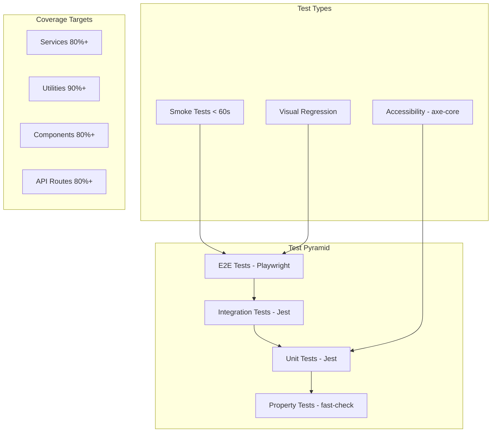

# Design Document: Comprehensive Testing

## Overview

This design establishes a multi-layered testing architecture for the Heiwa surf retreat booking platform. The architecture addresses critical coverage gaps: only 0.8% component coverage (2/234 components) and 6% library coverage (3/49 files). The design implements unit tests, integration tests, property-based tests, smoke tests, visual regression tests, and accessibility tests using Jest, Playwright, fast-check, and axe-core.

## Architecture



## Components and Interfaces

### Test Directory Structure

```
tests/
├── unit/
│   ├── lib/
│   │   ├── booking-service.test.ts
│   │   ├── email-service.test.ts
│   │   ├── stripe.test.ts
│   │   ├── rate-limiter.test.ts
│   │   ├── booking-utils.test.ts
│   │   ├── image-utils.test.ts
│   │   ├── date-helpers.test.ts
│   │   └── cms-validators.test.ts
│   └── components/
│       ├── ui/
│       │   ├── button.test.tsx
│       │   ├── input.test.tsx
│       │   ├── select.test.tsx
│       │   └── ...
│       ├── booking-widget/
│       │   ├── BookingWidget.test.tsx
│       │   ├── DatePicker.test.tsx
│       │   └── ...
│       └── admin/
│           ├── BookingTable.test.tsx
│           └── ...
├── integration/
│   └── api/
│       ├── bookings.test.ts
│       ├── rooms.test.ts
│       ├── payments.test.ts
│       └── ...
├── property/
│   ├── booking-utils.property.test.ts
│   ├── date-helpers.property.test.ts
│   ├── price-formatting.property.test.ts
│   └── validation.property.test.ts
├── smoke/
│   └── critical-paths.spec.ts
└── accessibility/
    └── wcag-compliance.test.tsx
```

### Test Utilities Interface

```typescript
// tests/utils/test-helpers.ts
export interface TestHelpers {
  // Mock factories
  createMockBooking(overrides?: Partial<Booking>): Booking;
  createMockRoom(overrides?: Partial<Room>): Room;
  createMockClient(overrides?: Partial<Client>): Client;
  createMockPayment(overrides?: Partial<Payment>): Payment;
  
  // API mocking
  mockApiResponse<T>(endpoint: string, response: T): void;
  mockApiError(endpoint: string, status: number, message: string): void;
  
  // Date utilities
  createFutureDate(daysFromNow: number): Date;
  createPastDate(daysAgo: number): Date;
  
  // Render utilities
  renderWithProviders(component: React.ReactElement): RenderResult;
  renderWithRouter(component: React.ReactElement, route?: string): RenderResult;
}

// tests/utils/generators.ts (for property-based testing)
export interface Generators {
  // Booking generators
  validBookingArb: fc.Arbitrary<BookingSubmission>;
  invalidBookingArb: fc.Arbitrary<BookingSubmission>;
  
  // Date generators
  validDateRangeArb: fc.Arbitrary<{ checkIn: Date; checkOut: Date }>;
  pastDateArb: fc.Arbitrary<Date>;
  futureDateArb: fc.Arbitrary<Date>;
  
  // Price generators
  validPriceArb: fc.Arbitrary<number>;
  currencyCodeArb: fc.Arbitrary<string>;
  
  // Email generators
  validEmailArb: fc.Arbitrary<string>;
  invalidEmailArb: fc.Arbitrary<string>;
}
```

### Service Test Interface

```typescript
// tests/unit/lib/booking-service.test.ts
describe('BookingService', () => {
  describe('submitBooking', () => {
    it('should submit valid booking successfully');
    it('should return validation errors for invalid booking');
    it('should handle network failures gracefully');
    it('should include submission timestamp');
  });
  
  describe('validateBooking', () => {
    it('should validate required fields');
    it('should validate email format');
    it('should validate date ranges');
    it('should validate minimum stay requirement');
    it('should return warnings for large groups');
  });
  
  describe('calculateEstimatedCost', () => {
    it('should calculate correct number of nights');
    it('should return correct currency');
    it('should include breakdown details');
  });
});
```

## Data Models

### Test Configuration Schema

```typescript
// jest.config.extended.js
interface ExtendedJestConfig {
  // Coverage thresholds
  coverageThreshold: {
    global: {
      branches: 80;
      functions: 80;
      lines: 80;
      statements: 80;
    };
    './lib/': {
      branches: 85;
      functions: 90;
      lines: 85;
    };
    './components/': {
      branches: 75;
      functions: 80;
      lines: 80;
    };
  };
  
  // Test categorization
  projects: [
    { displayName: 'unit', testMatch: ['**/tests/unit/**/*.test.ts(x)?'] },
    { displayName: 'integration', testMatch: ['**/tests/integration/**/*.test.ts'] },
    { displayName: 'property', testMatch: ['**/tests/property/**/*.property.test.ts'] },
  ];
}
```

### Property Test Result Schema

```typescript
interface PropertyTestResult {
  propertyName: string;
  iterations: number;
  passed: boolean;
  failingExample?: {
    input: unknown;
    expected: unknown;
    actual: unknown;
    shrunkInput?: unknown;
  };
  seed: number;
  duration: number;
}
```

## Correctness Properties

*A property is a characteristic or behavior that should hold true across all valid executions of a system—essentially, a formal statement about what the system should do. Properties serve as the bridge between human-readable specifications and machine-verifiable correctness guarantees.*

### Property 1: Booking Validation Completeness

*For any* booking submission with missing required fields, the validation function SHALL return isValid: false and include all missing fields in the errors array.

**Validates: Requirements 1.5, 1.6**

### Property 2: Date Range Validity

*For any* valid date range where checkOut > checkIn, the calculateEstimatedCost function SHALL return a positive number of nights equal to the difference in days.

**Validates: Requirements 2.1, 2.3**

### Property 3: Email Validation Consistency

*For any* string that matches the email regex pattern, the isValidEmail function SHALL return true, and for any string that does not match, it SHALL return false.

**Validates: Requirements 1.2, 1.6**

### Property 4: Price Formatting Round-Trip

*For any* valid price amount and currency code, formatting then parsing the price SHALL produce the original numeric value (within floating-point tolerance).

**Validates: Requirements 2.1, 4.3**

### Property 5: Room Image Processing Idempotence

*For any* room with valid images, calling processRoomImages multiple times with the same input SHALL produce identical output arrays.

**Validates: Requirements 2.2, 4.7**

### Property 6: Validation Error Message Completeness

*For any* validation result with errors, the getValidationErrorMessage function SHALL return a non-empty string containing information about at least one error.

**Validates: Requirements 1.6, 11.3**

### Property 7: Guest Details Validation Consistency

*For any* guest details array, if all guests have valid firstName, lastName, and email, the validation SHALL pass; if any guest is missing required fields, validation SHALL fail.

**Validates: Requirements 9.3, 9.5**

### Property 8: API Response Shape Consistency

*For any* successful API response, the response SHALL contain a success: true field and a data object; for any error response, it SHALL contain success: false and an error message.

**Validates: Requirements 5.2, 5.3**

### Property 9: Component Render Stability

*For any* UI component with valid props, rendering the component SHALL not throw an error and SHALL produce a non-null result.

**Validates: Requirements 3.2, 3.5**

### Property 10: Accessibility Attribute Presence

*For any* interactive component (button, input, link), the rendered output SHALL include appropriate ARIA attributes and keyboard event handlers.

**Validates: Requirements 8.4, 8.5**

## Error Handling

### Test Error Categories

| Error Type | Handling Strategy | Test Approach |
|------------|-------------------|---------------|
| Network Failure | Retry with backoff, show user message | Mock fetch to reject, verify error state |
| Validation Error | Display field-specific errors | Test with invalid inputs, verify error messages |
| Authentication Error | Redirect to login | Mock 401 response, verify redirect |
| Rate Limit Error | Show retry message with countdown | Mock 429 response, verify UI feedback |
| Server Error | Log error, show generic message | Mock 500 response, verify error boundary |

### Error Boundary Testing

```typescript
// Test error boundaries catch and display errors appropriately
describe('ErrorBoundary', () => {
  it('should catch rendering errors and display fallback UI');
  it('should log errors to monitoring service');
  it('should allow recovery via retry button');
  it('should not catch errors in event handlers');
});
```

## Testing Strategy

### Dual Testing Approach

The testing strategy employs both unit tests and property-based tests as complementary approaches:

- **Unit tests**: Verify specific examples, edge cases, and error conditions with known inputs and expected outputs
- **Property tests**: Verify universal properties across randomly generated inputs (minimum 100 iterations per property)

### Test Framework Configuration

**Property-Based Testing Library**: fast-check (v4.5.0)

```typescript
// Property test configuration
const propertyTestConfig = {
  numRuns: 100,           // Minimum iterations per property
  seed: Date.now(),       // Reproducible with seed
  verbose: true,          // Show failing examples
  endOnFailure: true,     // Stop on first failure for debugging
};
```

### Test Tagging Convention

Each property test MUST be tagged with:
```typescript
/**
 * Feature: comprehensive-testing
 * Property 1: Booking Validation Completeness
 * Validates: Requirements 1.5, 1.6
 */
```

### Coverage Requirements

| Layer | Target Coverage | Rationale |
|-------|-----------------|-----------|
| Services (lib/) | 80% lines, 90% functions | Core business logic |
| Utilities (lib/utils) | 90% lines | Pure functions, easy to test |
| Components (components/) | 80% lines | UI behavior verification |
| API Routes (app/api/) | 80% lines | Contract verification |

### Smoke Test Suite

Smoke tests must complete in under 60 seconds and verify:
1. Homepage loads (< 3s)
2. Booking widget renders
3. Admin login succeeds
4. API health check responds

### Accessibility Testing

Using axe-core for WCAG 2.1 Level AA compliance:
- Color contrast ratios
- Keyboard navigation
- ARIA attributes
- Focus management
- Screen reader compatibility

### Visual Regression Testing

Using Playwright's screenshot comparison:
- Capture baseline screenshots for all UI components
- Compare against baselines on each test run
- 0.1% pixel difference threshold
- Test at mobile (375px), tablet (768px), and desktop (1280px) viewports
