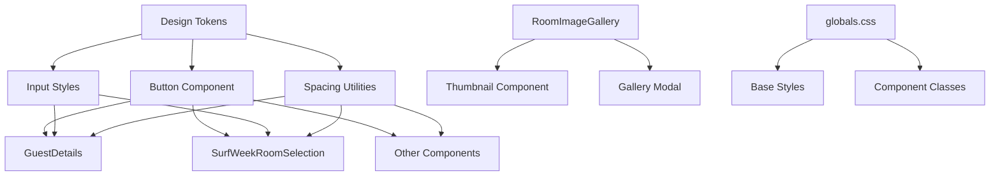

# Design Document: UI Pixel-Perfection Remediation

## Overview

This design document outlines the technical approach for achieving pixel-perfect UI across the Heiwa House booking application. The remediation focuses on the Button system, spacing tokens, typography hierarchy, form density, and specific component fixes identified through user feedback.

The implementation follows a token-based design system approach, centralizing all visual values in design tokens and propagating changes through component updates.

## Architecture



### Design System Layers

1. **Design Tokens Layer** (`components/BookingWidget/styles/design-tokens.ts`)
   - Centralized spacing scale
   - Typography scale
   - Color tokens
   - Animation tokens

2. **Component Layer** (`components/ui/button.tsx`)
   - Button variants with TOON-compliant styles
   - Consistent sizing and spacing

3. **Application Layer** (Booking Widget components)
   - Components consume tokens
   - Consistent application of spacing and typography

## Components and Interfaces

### Updated Design Tokens

```typescript
// components/BookingWidget/styles/design-tokens.ts
export const bookingWidgetTokens = {
  // TOON-compliant spacing scale
  spacing: {
    xs: '4px',    // 0.25rem
    sm: '8px',    // 0.5rem
    md: '12px',   // 0.75rem
    lg: '16px',   // 1rem
    xl: '24px',   // 1.5rem
    xxl: '32px',  // 2rem
  },
  
  // TOON-compliant typography
  typography: {
    fontSizes: {
      xs: '12px',   // Labels, helper text
      sm: '13px',   // Secondary buttons
      base: '14px', // Primary buttons, inputs
      lg: '16px',   // Headings
    },
    fontWeights: {
      normal: 400,
      medium: 500,
    },
    lineHeights: {
      tight: 1.2,
      normal: 1.5,
    },
  },
  
  // Button-specific tokens
  button: {
    minHeight: '40px',
    paddingX: '16px',
    paddingY: '10px',
    borderRadius: '10px',
    fontSize: {
      primary: '14px',
      secondary: '13px',
    },
    fontWeight: 500,
    opticalOffset: '-0.5px',
  },
  
  // Input-specific tokens
  input: {
    height: '40px',
    paddingX: '12px',
    paddingY: '8px',
    borderRadius: '10px',
    fontSize: '14px',
  },
  
  // Form layout tokens
  form: {
    labelSpacing: '6px',
    elementGap: '16px',
    groupSpacing: '24px',
    ctaMarginTop: '24px',
    containerPadding: '16px',
  },
  
  // Interaction tokens
  interactions: {
    hoverTranslateY: '-1px',
    activeScale: '0.98',
    transitionDuration: '150ms',
    transitionEasing: 'ease-out',
  },
  
  // Icon tokens
  icons: {
    textGap: '8px',
    sizeRatio: 0.9,
  },
} as const;
```

### Updated Button Component Interface

```typescript
// components/ui/button.tsx
interface ButtonProps {
  variant?: 'default' | 'secondary' | 'destructive' | 'outline' | 'ghost' | 'link';
  size?: 'default' | 'sm' | 'lg' | 'icon';
  asChild?: boolean;
  className?: string;
  children?: React.ReactNode;
}

// Style mapping
const buttonStyles = {
  base: `
    inline-flex items-center justify-center gap-2
    font-medium rounded-[10px]
    min-h-[40px] px-4 py-2.5
    text-sm leading-[1.2]
    transition-all duration-150 ease-out
    focus:outline-none focus:ring-2 focus:ring-offset-2
    disabled:opacity-50 disabled:pointer-events-none
    hover:-translate-y-px hover:shadow-md
    active:translate-y-0 active:scale-[0.98]
  `,
  variants: {
    default: 'bg-accent text-white hover:bg-accent-dark',
    secondary: 'bg-gray-800 text-white text-[13px] hover:bg-gray-900',
    destructive: 'bg-red-600 text-white text-[13px] hover:bg-red-700',
    // ... other variants
  },
};
```

### RoomImageGallery Fallback Enhancement

```typescript
// components/BookingWidget/components/RoomImageGallery.tsx
interface ImageWithFallbackProps {
  src: string;
  alt: string;
  fallbackSrc?: string;
  className?: string;
  onLoad?: () => void;
}

// Robust image component with fallback chain
const ImageWithFallback: React.FC<ImageWithFallbackProps> = ({
  src,
  alt,
  fallbackSrc = '/images/DSC02099-scaled.jpg',
  className,
  onLoad,
}) => {
  const [imgSrc, setImgSrc] = useState(src);
  const [hasError, setHasError] = useState(false);

  const handleError = () => {
    if (!hasError) {
      setHasError(true);
      setImgSrc(fallbackSrc);
    }
  };

  return (
    
  );
};
```

## Data Models

### Spacing Scale Type

```typescript
type SpacingKey = 'xs' | 'sm' | 'md' | 'lg' | 'xl' | 'xxl';
type SpacingValue = '4px' | '8px' | '12px' | '16px' | '24px' | '32px';

interface SpacingScale {
  [K in SpacingKey]: SpacingValue;
}
```

### Button Size Configuration

```typescript
interface ButtonSizeConfig {
  minHeight: string;
  paddingX: string;
  paddingY: string;
  fontSize: string;
  fontWeight: number;
}

const buttonSizes: Record<string, ButtonSizeConfig> = {
  default: {
    minHeight: '40px',
    paddingX: '16px',
    paddingY: '10px',
    fontSize: '14px',
    fontWeight: 500,
  },
  sm: {
    minHeight: '36px',
    paddingX: '12px',
    paddingY: '8px',
    fontSize: '13px',
    fontWeight: 500,
  },
  lg: {
    minHeight: '44px',
    paddingX: '20px',
    paddingY: '12px',
    fontSize: '14px',
    fontWeight: 500,
  },
};
```

## Correctness Properties

*A property is a characteristic or behavior that should hold true across all valid executions of a system—essentially, a formal statement about what the system should do. Properties serve as the bridge between human-readable specifications and machine-verifiable correctness guarantees.*

### Property 1: Button Typography Consistency

*For any* button rendered with the Button component, the computed font-size SHALL be 14px for primary/default variants and 13px for secondary/destructive variants, with font-weight of 500.

**Validates: Requirements 1.1, 1.2, 3.4**

### Property 2: Button Dimensions Compliance

*For any* button rendered with the Button component, the computed styles SHALL include: min-height of 40px, horizontal padding of at least 16px, vertical padding of at least 10px, and border-radius of 10px.

**Validates: Requirements 1.3, 1.4, 1.5**

### Property 3: Input Field Dimensions

*For any* input field in the Booking Widget, the computed styles SHALL include: height of 40px, border-radius of 10px, horizontal padding of 12px, and vertical padding of 8px.

**Validates: Requirements 4.1, 4.2, 4.3**

### Property 4: Spacing Scale Definition

*For any* access to the design tokens spacing scale, the returned values SHALL match exactly: xs=4px, sm=8px, md=12px, lg=16px, xl=24px, xxl=32px.

**Validates: Requirements 2.1**

### Property 5: Form Spacing Consistency

*For any* form container in the Booking Widget, the container padding SHALL be at least 16px, vertical gaps between form elements SHALL be 12-16px, and CTA buttons SHALL have top margin of at least 24px.

**Validates: Requirements 2.2, 2.3, 2.4, 4.4, 4.5**

### Property 6: Typography Hierarchy

*For any* form in the Booking Widget, labels SHALL have font-size 12px with font-weight 500, input text SHALL have font-size 14px with font-weight 400, and helper text SHALL have font-size 12px.

**Validates: Requirements 3.1, 3.2, 3.3**

### Property 7: Pricing Format Correctness

*For any* room upgrade price displayed in SurfWeekRoomSelection, the format SHALL use "from €X" prefix instead of "+€X" prefix.

**Validates: Requirements 5.1**

### Property 8: Image Fallback Handling

*For any* image in RoomImageGallery that fails to load, the component SHALL display a valid fallback image from the FALLBACK_IMAGES array without showing a broken image indicator.

**Validates: Requirements 6.1, 6.2, 6.4**

### Property 9: Icon-Text Alignment

*For any* icon displayed alongside text in the Booking Widget, the gap between icon and text SHALL be 8px, and icons SHALL be vertically aligned with the text.

**Validates: Requirements 7.1, 7.3**

### Property 10: Interaction State Transitions

*For any* button with hover/active states, hover SHALL apply translateY of -1px, active SHALL apply scale of 0.98, and transitions SHALL use duration of 150ms with ease-out easing.

**Validates: Requirements 8.1, 8.2, 8.3**

## Error Handling

### Image Loading Errors

1. **Primary Strategy**: Use `onError` handler to swap to fallback image
2. **Fallback Chain**: Property-specific images → Generic placeholder
3. **State Management**: Track error state to prevent infinite fallback loops

```typescript
const handleImageError = (e: React.SyntheticEvent<HTMLImageElement>) => {
  const target = e.target as HTMLImageElement;
  if (!hasError) {
    setHasError(true);
    target.src = FALLBACK_IMAGES[0];
  }
};
```

### Missing Icon Handling

Lucide React icons are bundled, so missing icons are unlikely. However, if custom icons are added:

1. Wrap icon imports in try-catch
2. Provide fallback icon component
3. Log missing icon errors for debugging

## Testing Strategy

### Unit Tests

Unit tests verify specific examples and edge cases:

1. **Button Component Tests**
   - Verify each variant renders with correct classes
   - Test size prop applies correct dimensions
   - Test disabled state styling

2. **Design Token Tests**
   - Verify token values match specification
   - Test token export structure

3. **Image Fallback Tests**
   - Test error handler triggers fallback
   - Test fallback image loads successfully

### Property-Based Tests

Property-based tests verify universal properties across all inputs using fast-check:

1. **Button Styling Properties**
   - Generate random button variants and verify computed styles
   - Minimum 100 iterations per property

2. **Spacing Scale Properties**
   - Verify all spacing values conform to scale
   - Test spacing application in components

3. **Typography Properties**
   - Verify font sizes across component hierarchy

### Test Configuration

- **Framework**: Jest + React Testing Library
- **Property Testing**: fast-check
- **Minimum Iterations**: 100 per property test
- **Tag Format**: `Feature: ui-pixel-perfection, Property N: {property_text}`

### Visual Regression Testing

For pixel-perfection validation:

1. Capture screenshots of key components
2. Compare against baseline images
3. Flag any pixel differences > 0.1%
